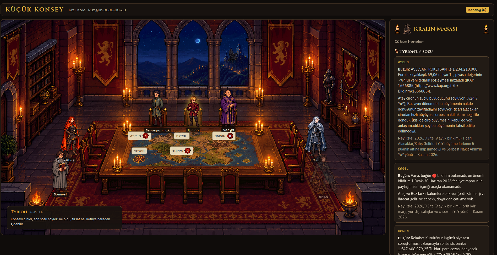

# Küçük Konsey

BIST piyasasının gündemini KAP bildirimleri, ekonomi haberleri ve fiyat hareketlerinden çıkaran,
tartışan ve haftada üç kez bir dakikada okunacak bir özet yazan çok ajanlı sistem.
Her ajan bir Game of Thrones karakteri; kullanıcı tahtta, ajanlar Küçük Konsey'de.

**Fiyat tahmini yapmaz, al/sat demez.** Araştırma ve finans öğrenme aracı, yatırım tavsiyesi değil.



## Mimari

```
              ┌──────── toplayıcı (Python, LLM yok, 08:30 / 20:00) ────────┐
KAP (BIST 30) ┤                                                             │
6 RSS kaynağı ┼──→  SQLite: belgeler + fiyatlar + FTS5 dizini  (veri/konsey.db)
borsapy fiyat ┘                       │
                                      ▼
                   arsiv MCP (salt okunur): son_belgeler · ara · belge · fiyat_hareketleri
                                      │
/konsey ──────────────────────────────┼──────────────────────────────────────────────
  1. Varys         başlıkları tarar, 3-6 tema çıkarır, en fazla 3'ünü tartışmaya seçer
  2. Serçeparmak   BIST 30 fiyat/hacim hareketleri ↔ gündem eşleştirmesi (neden-sonuç kurmaz)
  3. Ateş ║ Buz    tema başına fırsat / risk; paralel, birbirini görmeden (debate)
  4. Tyrion        denetler, önem sırasına koyar, yorumlar: "Tyrion'un sözü"
  5. Samwell       günün finans kavramını o günün verisiyle anlatır
                                      │
                       kuzgunlar/<tarih>.md  →  Westeros arayüzü
```

Haber kaynakları: AA, Bloomberg HT, TRT Haber (yurtiçi) · CNBC, BBC, FT (yurtdışı).

`/konsey derin <SEMBOL>` tek hisse için canlı KAP ve bilanço kalemleriyle derin analiz yapar.
Gündem turunda Tyrion bir hisse önerebilir; derin turu kullanıcı başlatır.

## Tasarım kararları

**Veri katmanı**
- **Toplama ile işleme ayrı.** RSS beslemeleri yalnız son birkaç saatin haberini tutar. Ucuz toplayıcı
  günde iki kez çalışıp her şeyi biriktirir, pahalı LLM ajanları haftada üç kez birikmiş veriyi okur.
- **İdempotent toplama.** `UNIQUE (kaynak, dis_id)` aynı belgenin iki kez girmesini veritabanı
  düzeyinde engeller. Ağ hatasında belge kaydedilmez, bir sonraki tur kendiliğinden tekrar dener.
- **KAP'a nazik istemci.** 2 sn aralık, 429'da üstel geri çekilme ve `Retry-After`'a uyma, art arda
  redde **devre kesici** (tur durur, veri kaybolmaz). İlk sürüm 0,5 sn aralıkla ~80 istekte engellenmişti.
- **Zamanlar UTC**, fiyat tarihleri borsanın takvim günü. Seans içi fiyat `UPSERT` ile akşam kapanışla düzelir.

**Arama (RAG'in "R"si)**
- **SQLite FTS5 + BM25**, başlık 10 / özet 5 / metin 1 ağırlıklı. Tek kullanıcı ve tek yazan süreç için
  ayrı bir arama sunucusu (Elasticsearch) gereksiz; aynı sıralama algoritması dosya içinde.
- **Türkçe:** `İ`/`I`/`ı` normalizasyonu (Python'da `"İ".lower()` iki karakter döner), ek sorunu için
  önek araması: "ihracat" 7 sonuç, "ihracat*" 22 sonuç.
- **Bilinen sınır, ölçüldü:** kelime araması anlamı bilmez. "temettü" araması "Kâr Payı Dağıtım"
  bildirimini bulmuyor. Sıradaki adım anlamsal arama (embedding) ve hibrit sıralama.

**Ajanlar**
- **İş akışı, özerk ajan değil.** Sıra sabit; tek LLM karar noktası Varys'ın tema seçimi. Öngörülebilir,
  ucuz, hata ayıklaması kolay.
- **En az yetki.** Ajanlar yalnız işlerinin aracını alır. Arşiv bağlantısı salt okunur; Ateş/Buz dosya
  yazamaz, arama yapamaz.
- **Katmanlı prompt injection savunması.** Haber ve bildirim metni veridir, talimat değil: salt okunur
  veritabanı + kısıtlı araçlar + "şüpheli içerik" işaretleme talimatı.
- **Yanlışlanabilir iddialar.** Her tez tarihli ve arşivden denetlenebilir bir "yanıldığımı şundan
  anlarım" koşulu taşır (`hisar/iddialar/`); ileride gerçekleşenle karşılaştırılır.
- **Her sayı kaynaklı.** Özetteki her rakam KAP numarasına ya da haber bağlantısına bağlanır.
- **Biçim bekçisi.** `scripts/brief_kontrol.py` Tyrion'un özetini yayından önce kodla doğrular
  (madde sayısı, zorunlu alanlar, "Neyi izle"de sayı yasağı).

**Ölçümle düzeltilen bir prompt hatası** (`docs/degerlendirme/`): ilk turda Ateş ve Buz altı temanın hiçbirinde
tez kurmadı; derin moda ait sayı kuralları gündem moduna da uygulanmıştı (aşırı kısıt → ret). Kapsam
ayrımı ve güç etiketi (zayıf/orta/güçlü) eklendikten sonra 0 → 4 tez; etiketler dürüst kaldı ve iki ajan
Varys'ın bir sınıflandırma hatasını (AMB'yi Türkiye makrosuna koyması) bağımsız olarak yakaladı.

## Kurulum

Gerekenler: Python 3.12+, [uv](https://docs.astral.sh/uv/), Node.js, [Claude Code](https://claude.com/claude-code).

```sh
uv sync
uv run pytest                    # internetsiz: kayıtlı KAP sayfaları ve geçici veritabanı
uv run python -m toplayici       # ilk veri: haber, fiyat, KAP
```

Zamanlayıcı (günde iki tur, bilgisayar kapalıysa açılınca telafi eder):

```sh
cp scripts/systemd/konsey-toplayici.* ~/.config/systemd/user/
systemctl --user daemon-reload && systemctl --user enable --now konsey-toplayici.timer
journalctl --user -u konsey-toplayici -n 20     # son turların çıktısı
```

MCP sunucuları repo kökündeki `.mcp.json` içinde tanımlı (`arsiv`, `kap`, `borsa`). Repo klasöründe
`claude` ile oturumu aç ve `/konsey` çalıştır.

Arayüz:

```sh
npm --prefix web install && npm --prefix web run build
python3 scripts/web_server.py    # http://127.0.0.1:8765
```

## Proje yapısı

| Klasör | İçerik |
| --- | --- |
| `toplayici/` | KAP, RSS ve fiyat toplayıcıları, SQLite şeması |
| `arama/` | FTS5 kelime araması ve `arsiv` MCP sunucusu |
| `kap/` | Canlı KAP MCP sunucusu (derin mod) |
| `.claude/agents/` | Ajan tanımları |
| `.claude/skills/konsey/` | Orkestrasyon: `/konsey` akışı |
| `hisar/` | Ajan hafızası: hisse dosyaları, kavramlar, iddia defteri, kurallar |
| `kuzgunlar/` | Üretilen özetler |
| `web/` | Westeros arayüzü (React + TypeScript) |

## Sırada

- Anlamsal arama (embedding) + hibrit sıralama; "temettü / kâr payı" gibi ölçülmüş boşluklarla gerekçeli
- Soru setiyle (golden set) arama kalitesinin ölçümü
- Bran: iddia defterini gerçekleşen veriyle haftalık karşılaştırma
